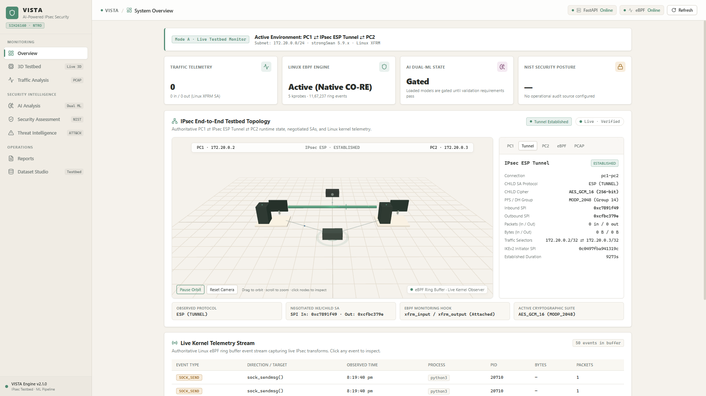
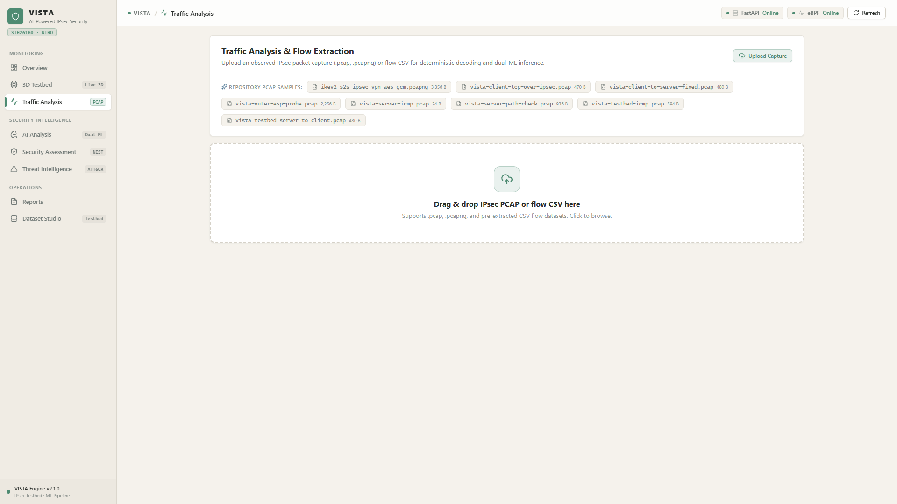
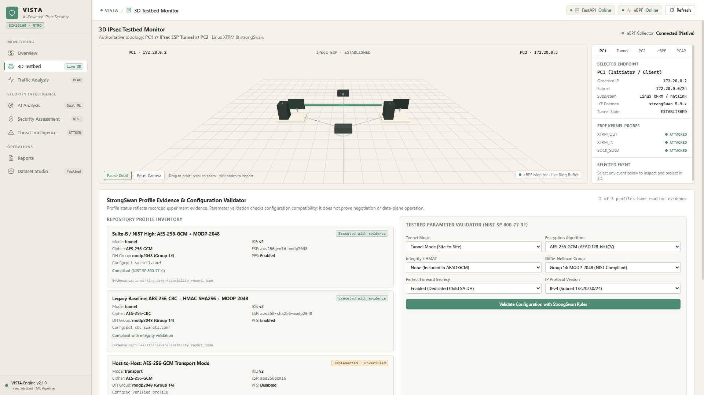
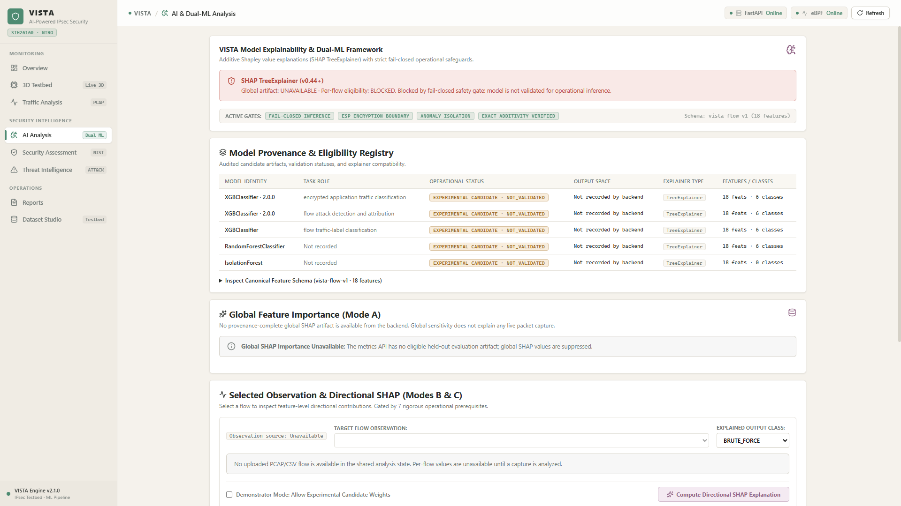
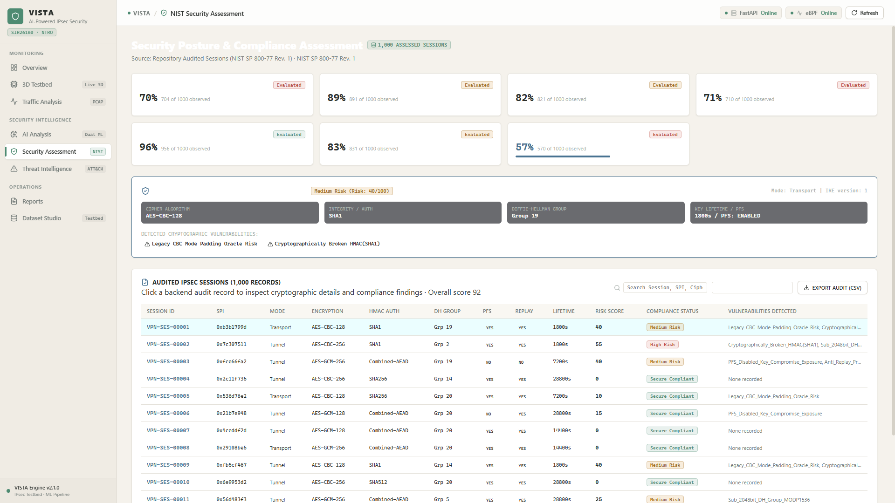
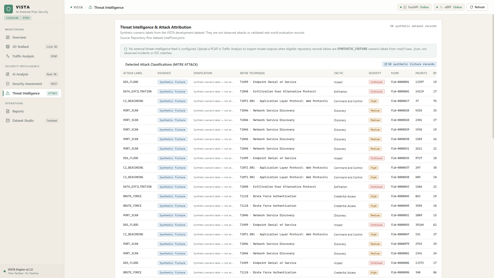
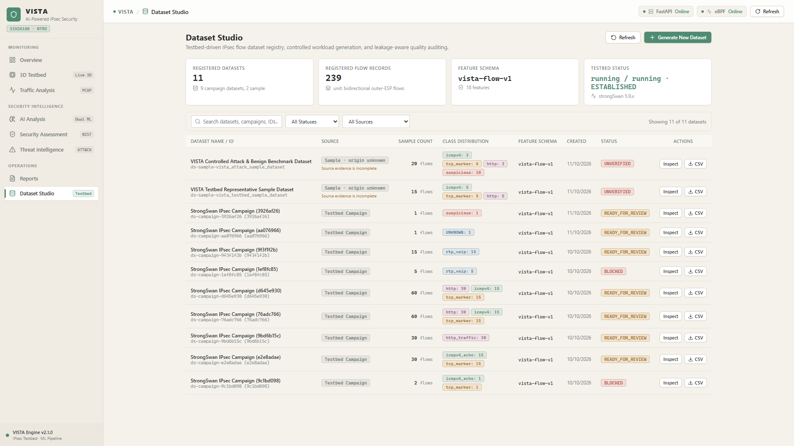
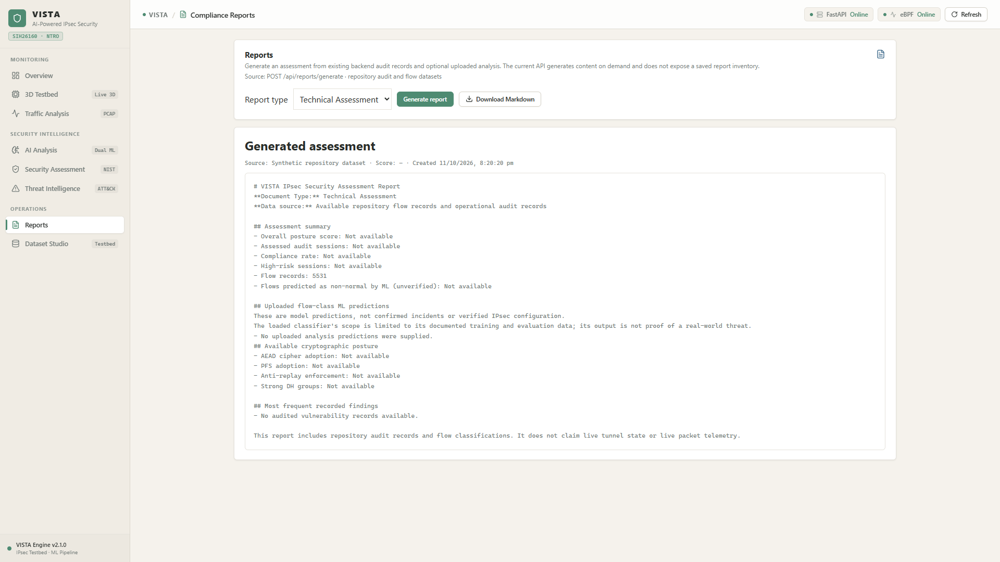

# VISTA: AI-Powered IPsec VPN Protocol Analyzer & Security Assessment Framework
### Smart India Hackathon 2026 · Problem Statement SIH26160
**Organization:** National Technical Research Organisation (NTRO)  
**Theme:** Blockchain & Cybersecurity  

---

## 1. Overview

VISTA is a prototype for analyzing IPsec VPN captures and a controlled two-endpoint testbed. It extracts observable protocol and flow metadata without decrypting payloads. It includes ML artifacts, posture rules, threat views, dataset tools, and reports, but their operational validity varies: current model artifacts are gated from inference, posture scores are unavailable without operational audit evidence, and repository threat records are synthetic. See the evidence matrix and provenance documents before treating a result as an operational finding.

---

## 2. User Interface Showcase

The VISTA SOC platform provides a unified operations console for defense analysts, SOC operators, and cryptographic auditors.

### 2.1 IPsec Security Overview & Posture Dashboard
> Displays backend, testbed, and eBPF status when available. Operational compliance scores and metadata risk are unavailable without validated audit inputs.



---

### 2.2 Encrypted Traffic Intelligence & Flow Inspector
> Inspects capture metadata without decrypting payloads. Sample counts and model predictions must be interpreted with their provenance; predictions are not confirmed classifications.



---

### 2.3 3D Interactive PC1 ↔ PC2 IPsec Testbed & Kernel eBPF Telemetry
> Interactive visualization of the direct PC1 ↔ PC2 tunnel and available SA/eBPF observations. Socket telemetry is not reliably correlated to individual flows.



---

### 2.4 AI Intelligence & ML Model Registry
> Model artifacts and historical offline metrics are available, but the current backend marks every loaded model `inferenceEnabled=false` and `not_validated`. No operational capture predictions are available. The saved results use synthetic development data and are not real-world attack-detection evidence.



---

### 2.5 Security Posture & NIST SP 800-77 Compliance Engine
> Applies rules to explicit session inputs. The current runtime has no operational audit records, so it does not establish a live compliance score or findings for 1,000+ sessions.



---

### 2.6 Threat Intelligence & MITRE ATT&CK® Enterprise Mapping
> Shows repository scenario labels and available flow data. Current synthetic records are not live incidents or confirmed IOCs.



---

### 2.7 Dataset Studio & Testbed-Driven Dataset Generation
> Dataset registry, collection, validation, and export workflows are implemented with mixed evidence and readiness states. Registry row counts do not imply all records are validated or evaluation-ready.



---

### 2.8 Audit Documentation & Automated Compliance Reporting
> Generates Markdown reports from available records. Missing operational measurements remain unavailable; PDF output is not implemented.



---

## 3. System Architecture

```
┌────────────────────────────────────────────────────────────────────────┐
│                   VISTA MODE B ARCHITECTURE MAP                        │
│                                                                        │
│  [ frontend: vista-dashboard/ ] ──(REST / WebSocket)──┐                │
│    • React + Vite SOC Dashboard                       │                │
│    • In-browser PCAP & CSV parser (fallback)          ▼                │
│    • 3D WebGL Duplex Peering Canvas        [ backend: FastAPI API ]    │
│    • Posture rules (score needs audit data)  • /api/analyze/pcap       │
│                                              • /api/analyze/csv        │
│  [ topology: Mode B IPsec Testbed ]          • /api/audit/sessions     │
│    • pc1 (IPsec endpoint: 172.20.0.2)         • /api/soc/status         │
│    • pc2 (IPsec endpoint: 172.20.0.3)         • /api/ml/metrics         │
│    • Direct Tunnel Mode (ESP / Proto 50)     • /api/ebpf/events        │
│    • Current IKE: AES-CBC/SHA-256, MODP-2048          │                │
│    • Current ESP: AES-GCM-16, PFS MODP-2048            │                │
│                                                       ▼                │
│                                            [ vista-ml: AI Engine ]     │
│  [ captures/ ] ──(PCAP Replay)─────────────> • Scapy Packet Decoder    │
│    • StrongSwan ESP & IKE PCAPs              • Experimental ML artifacts│
│    • eBPF Socket / XFRM Kernel Telemetry     • Inference disabled       │
│                                              • Global synthetic SHAP    │
└────────────────────────────────────────────────────────────────────────┘
```

---

## 4. Quick Start & Execution

### Option A: One-Click Launch (PowerShell)
```powershell
powershell -ExecutionPolicy Bypass -File .\start_vista.ps1
```
This automatically starts:
1. **FastAPI AI Core API** at `http://localhost:8000` (Interactive docs at `/docs`)
2. **Vite Cyber SOC Dashboard** at `http://localhost:5173`

---

### Option B: Manual Execution

#### 1. Start the FastAPI Backend
```bash
# From the repository root:
.\.venv\Scripts\python run_backend.py --port 8000
```
- API Health: `http://localhost:8000/`
- Swagger UI: `http://localhost:8000/docs`

#### 2. Start the Frontend Dashboard
```bash
cd vista-dashboard
npm install
npm run dev
```
Open `http://localhost:5173` in your browser.

---

## 5. Key Capabilities & Implemented Features

### 5.1 Real Packet Analysis & IKE Parsing
- **ESP Packet Extraction (Protocol 50):** Automatically decodes Security Parameter Index (SPI) values directly from raw packets (e.g., `0xc6dd300d`).
- **IKEv1 / IKEv2 Negotiation Parsing (UDP 500 & NAT-T 4500):** Decodes ISAKMP headers, Initiator/Responder SPIs, exchange types (IKE_SA_INIT), and extracts the exact major/minor protocol version byte.

### 5.2 Flow Classification and Anomaly Scores
- **Model Artifacts:** XGBoost, Random Forest, traffic, attack, and anomaly artifacts load in the backend. The current `/api/status` reports `inferenceEnabled=false` and `validationStatus=not_validated` for every model; no operational predictions are available.
- **Artifact Classes:** Serialized classifiers contain class labels such as `NORMAL`, `DOS`, `PORT_SCAN`, `BRUTE_FORCE`, `C2_BEACONING`, and `DATA_EXFILTRATION`. Their presence in a model file does not mean VISTA can currently infer those classes from a capture.
- **Predictions and anomaly scores:** Model inference is fail-closed while validation and schema eligibility are missing. Saved synthetic metrics are not operational threat or risk scores.
- **Training and evaluation limits:** The root models are trained/evaluated using the synthetic VISTA development dataset. Its offline held-out metrics and global SHAP summary do not establish performance on real-world traffic; the SHAP report is not a per-capture explanation.
- **ONNX Exports:** Standalone ONNX files are present in `vista-ml/models/onnx/`; their presence does not establish a supported deployment or inference eligibility.
- **Explainability:** The API exposes global SHAP provenance for a synthetic held-out dataset. Local/per-flow explanations are gated because no model is validated for operational inference; the global artifact is not an explanation of an uploaded capture.

### 5.3 Deterministic NIST Compliance Engine
Evaluates session configurations against:
- **NIST SP 800-77 Rev. 1** (Guide to IPsec VPNs)
- **BSI TR-02102-3** (Cryptographic Mechanisms for IPsec)
Identifies vulnerabilities:
- Legacy 3DES (SWEET32) & CBC Padding Oracle risks
- Deprecated HMAC algorithms (MD5 / SHA-1)
- Sub-2048-bit Diffie-Hellman groups
### 5.4 Live eBPF Kernel Telemetry (Correlation Limited)
- **Linux collector (`ebpf/`):** Uses `bpftool` to generate `vmlinux.h` from `/sys/kernel/btf/vmlinux`, Clang to build a CO-RE `.bpf.o`, and libbpf to load/attach kprobes to XFRM (`xfrm_output`, `xfrm_input`) and socket send paths (`sock_sendmsg`, `udp_sendmsg`, `__sys_sendto`). Events use a libbpf ring buffer.
- **Runtime status:** `/api/ebpf/status` reports actual BTF availability and probe attachment. If BTF, capabilities, loading, or attachment fails, `/status` reports `UNAVAILABLE` and `/events` is empty; no synthetic kernel events are generated.
- **Collection boundary:** XFRM events include the skb length; inbound XFRM events include SPI. The socket hook records process metadata only. Current events do not reliably correlate to a particular flow.

To run the collector, use `docker compose --profile ebpf -f topology/docker-compose.yml up --build` on Linux or Docker Desktop WSL2 with readable kernel BTF and effective `CAP_BPF`/`CAP_PERFMON`. The `ebpf` profile is opt-in; the local collector API is exposed at `http://127.0.0.1:8765`.

---

## 6. Direct PC1 ↔ PC2 IPsec Testbed

`topology/docker-compose.yml` builds exactly two StrongSwan endpoints from `debian:bookworm-slim`: `pc1` (`172.20.0.2`) and `pc2` (`172.20.0.3`). They share one Compose-managed Docker bridge (`vista-pc-net`) and negotiate one direct IKEv2 tunnel with host-specific tunnel selectors (`172.20.0.2/32` ↔ `172.20.0.3/32`). IKE uses AES-256/SHA-256/MODP-2048 and ESP uses AES-256-GCM. There is no VPN gateway, protected server, forwarding, or SNAT service. The separate `vista-ebpf-monitor` profile is a passive host-kernel monitor, not an IPsec endpoint.

Start the two endpoints and the real CO-RE collector:
```powershell
docker compose --profile ebpf -f topology/docker-compose.yml up -d --build pc1 pc2 vista-ebpf-monitor
docker exec pc1 swanctl --list-sas
docker exec pc2 swanctl --list-sas
docker exec pc1 ping -c 10 172.20.0.3
docker exec pc2 ping -c 10 172.20.0.2
docker exec pc1 ip xfrm state
docker exec pc1 ip xfrm policy
docker exec pc2 ip xfrm state
docker exec pc2 ip xfrm policy
Invoke-RestMethod http://127.0.0.1:8765/status
Invoke-RestMethod 'http://127.0.0.1:8765/events?limit=500'
```

`pc1-cbc-swanctl.conf` / `pc2-cbc-swanctl.conf` are direct-peer AES-256-CBC comparison configurations; the default Compose tunnel uses AES-256-GCM.

The Overview dashboard's eBPF stream polls the backend API and shows received native collector events; it does not generate fallback/demo kernel events.

---

## 7. Verification & Test Suite

Run the full regression test suite (226 passed, 10 skipped, 0 failed):
```powershell
.\.venv\Scripts\python.exe -m pytest
```

Alternatively, run individual component test suites:
```powershell
# Backend and eBPF tests
.\.venv\Scripts\python.exe -m pytest backend ebpf

# ML tests (Phase 10 Optuna baselines, Phase 11 leakage audits, robustness, fixtures)
.\.venv\Scripts\python.exe -m pytest vista-ml/tests
```

Audit run results and environment limitations are recorded in [docs/TEST_RESULTS.md](docs/TEST_RESULTS.md). System boundaries, evidence, and SIH26160 coverage are in [docs/ARCHITECTURE.md](docs/ARCHITECTURE.md), [docs/DATA_PROVENANCE.md](docs/DATA_PROVENANCE.md), and [docs/SIH_REQUIREMENTS.md](docs/SIH_REQUIREMENTS.md). For the controlled demo, see [docs/DEMO_RUNBOOK.md](docs/DEMO_RUNBOOK.md).

Verify frontend build and lint:
```powershell
cd vista-dashboard
npm run lint
# Expected: 0 errors
npm run build
# Expected: built with 0 errors
```
