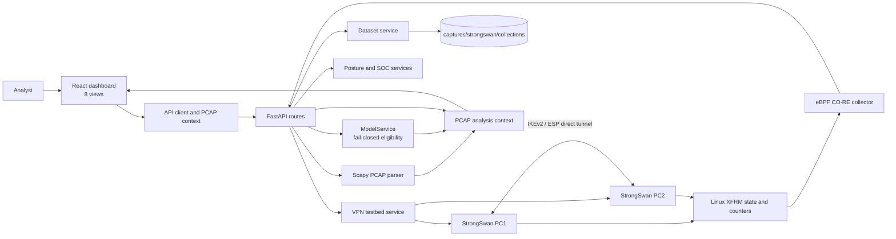

# VISTA System Architecture

**Scope:** Repository and runtime architecture for SIH26160. The status and data boundaries below reflect the code and runtime observations reviewed on 2026-10-11.

## System map

The only VPN endpoints are PC1 and PC2. The collector observes the host Linux kernel; it is not a third endpoint. PCAP and eBPF are separate observation paths and are not correlated unless a validated matching rule is available.

## Source of truth by capability

| Capability | Source of truth | Entry points and API | State and error boundary |
|---|---|---|---|
| Frontend navigation | `vista-dashboard/src/App.jsx` | `Sidebar`, `TopNav`, eight `components/views/*View.jsx` files | URL query `?tab=` persists navigation; `ErrorBoundary` isolates a view. |
| Uploaded PCAP/CSV analysis | Uploaded bytes and `backend/services/pcap_analyzer.py` result | `PcapAnalysisContext.jsx` → `apiClient.js` → `POST /api/analyze/pcap` or `/api/analyze/csv` | Result stays in frontend context across view navigation; analysis is independent of live tunnel telemetry. Empty/malformed files return API errors; absent model eligibility is represented in per-flow prediction status. |
| Model eligibility | Artifact metadata plus `ModelService._model_info()` and `predict()` gates | `backend/services/model_service.py`; `GET /api/status`; `GET /api/ml/metrics`; SHAP endpoints | Model files may load while inference stays disabled. `validated_for_inference`, schema version, and required inputs gate predictions. Current runtime models report `inferenceEnabled=false`. |
| StrongSwan runtime | Current `swanctl --list-sas --raw` and Linux XFRM state | `backend/services/vpn_testbed.py`; `GET /api/testbed/live-status` | Current observation includes endpoint state, negotiated IKE/CHILD SA, selectors, counters, and capture job. Errors or stale values must be surfaced as unavailable/stale, not replaced by previous configuration values. |
| Testbed configuration | Request validator, generated swanctl config, runtime plugin availability | `GET /api/testbed/profiles`, `POST /api/testbed/validate`, `POST /api/testbed/run` | Configuration validation means syntax/compatibility only. Runtime experiment status and artifacts are maintained separately in `captures/strongswan/capability_report.json` and per-experiment directories. |
| PCAP parser and features | Input PCAP bytes and canonical feature schema | `backend/services/pcap_analyzer.py`; `vista-ml/src/vista_ml/features/pcap_features.py`; `schemas/vista-flow-v1` | Outer ESP/IKE metadata is observable. Encrypted inner payloads are not decrypted or read. Feature order/schema mismatches and missing values must block inference. |
| eBPF telemetry | Linux kernel BTF, probe attachment, ring-buffer records | `ebpf/collector_server.py`, `libbpf_loader.c`, `vista_ipsec_monitor.bpf.c`; backend `/api/ebpf/status`, `/api/ebpf/events` | Native event history is bounded. Socket-send events are process observations; they do not prove flow attribution. Probe health is independent of proof a particular workload produced an XFRM event. |
| Security posture | Explicitly supplied session fields and `backend/services/posture_engine.py` rules | `GET /api/audit/sessions`, `GET /api/audit/summary` | Repository-generated audit scenarios are not operational findings. If no operational source exists, score and component metrics are null. Current runtime reports no operational audit source. |
| Threat intelligence | Flow evidence and source label/provenance | `backend/services/soc_service.py`; `GET/POST /api/soc/threats`, `GET /api/soc/status` | Dataset labels, unverified model predictions, heuristics, and observed security events remain separate. The Threat view labels current repository records synthetic. |
| Dataset Studio | Collection/session manifests, validation reports, and exported feature rows | `backend/services/dataset_service.py`; `/api/datasets*` | Files live under `captures/strongswan/collections/`. Dataset status and evidence metadata are persisted in manifests/reports; generation jobs are in-memory API job state. Export is path-validated. |
| Reports | Available repository audit/flow records plus optional uploaded analysis | `POST /api/reports/generate` | Generates Markdown; the response keeps posture unavailable without operational audits. PDF output is not implemented. |

## Dashboard data flow

| View | User action → API/service → rendered state |
|---|---|
| Overview | Opens the app → `/api/testbed/live-status`, `/api/ebpf/status`, `/api/ebpf/events`, `/api/audit/summary`, `/api/status` → renders current tunnel, counters, collector, and model eligibility. Uploaded analysis switches this view to the uploaded PCAP context; it is not merged with live telemetry. |
| 3D Testbed | Selects the Testbed view → live status, eBPF events/status, profile inventory → Three.js nodes and inspector show live observations; validator submits `/api/testbed/validate`. |
| Traffic Analysis | Uploads or selects a sample PCAP/CSV → `/api/analyze/pcap` or `/api/analyze/csv` → packet, SA and flow results are stored in `PcapAnalysisContext` and rendered in the flow inspector. |
| AI Analysis | Opens explainability view → `/api/status` and `/api/ml/shap/global` → eligibility, schema, evaluation provenance, and SHAP state render. Local SHAP calls `/api/ml/shap/explain-flow` and remain gated. The reference benchmark is synthetic and is not a live prediction. |
| Security Assessment | Opens assessment → `/api/audit/sessions` and `/api/audit/summary` → operational rows render only when backed by an operational source; current state is an explicit unavailable/empty state. |
| Threat Intelligence | Opens view → repository flow data or uploaded analysis flows → `/api/soc/threats` → classifications display with dataset/prediction provenance. Current repository records are synthetic scenario labels. |
| Reports | Selects report type and Generate → `POST /api/reports/generate` → returned Markdown is shown and can be downloaded. |
| Dataset Studio | Opens registry → `/api/datasets` and `/api/datasets/capabilities`; inspection/validation/export/generation use `/api/datasets/{id}*` and jobs routes → tables and real job state render. Collection jobs are not auto-trained or promoted. |

## Runtime dependencies and persistence

- **Backend:** Python 3.12 environment, FastAPI/Uvicorn, Scapy, pandas/NumPy, scikit-learn, XGBoost, and SHAP. Root API routes are in `backend/main.py`; service logic is in `backend/services/`.
- **Frontend:** React and Vite in `vista-dashboard/`; `src/utils/apiClient.js` is the shared HTTP client. Vite proxies `/api` to the backend. The dashboard does not have a separate backend service.
- **IPsec testbed:** Docker Compose and StrongSwan containers in `topology/`; Compose network and address plan are defined in `topology/docker-compose.yml`. Runtime tunnel operations require Linux kernel XFRM within the Docker host/WSL2 environment.
- **eBPF:** Optional Linux collector profile; requires readable kernel BTF, `bpftool`, Clang, libbpf, and effective BPF/perf capabilities. Windows itself does not attach these probes.
- **ML:** Python package in `vista-ml/`; model and evaluation metadata are kept with artifacts. Candidates are stored under candidate-only model/report paths and are not production inference sources by default.
- **Evidence:** Small fixtures and sample PCAPs are under `captures/`, `DATASET/`, and selected dashboard public assets. Runtime experiment and collection output is under `captures/strongswan/`; manifests retain source IDs, hashes, configs, labels, and validation results when available.
- **Environment variables:** The collector reads `VISTA_EBPF_COLLECTOR_URL`; StrongSwan entrypoint reads `VISTA_INITIATE` and `VISTA_CHILD`. No API secret is required for the local prototype.

## API route inventory

- Status: `GET /`, `GET /api/status`.
- Analysis: `POST /api/analyze/pcap`, `POST /api/analyze/csv`, `GET /api/captures/samples`, `GET /api/captures/samples/{filename}`.
- Audit/SOC: `GET /api/audit/sessions`, `GET /api/audit/summary`, `GET /api/soc/status`, `GET /api/soc/threats`, `POST /api/soc/threats`.
- ML/SHAP: `GET /api/ml/metrics`, `GET /api/ml/shap/status`, `GET /api/ml/shap/global`, `POST /api/ml/shap/explain-flow`.
- eBPF: `GET /api/ebpf/events`, `GET /api/ebpf/status`, `POST /api/ebpf/fuse`.
- Testbed: `GET /api/testbed/profiles`, `POST /api/testbed/validate`, `POST /api/testbed/run`, `GET /api/testbed/capability-report`, `GET /api/testbed/live-status`.
- Reports: `POST /api/reports/generate`.
- Dataset Studio: `GET /api/datasets`, `GET /api/datasets/capabilities`, `POST /api/datasets/preflight`, `POST /api/datasets/generate`, `GET /api/datasets/jobs/{job_id}`, `POST /api/datasets/jobs/{job_id}/cancel`, `GET /api/datasets/{dataset_id}`, `POST /api/datasets/{dataset_id}/validate`, `GET /api/datasets/{dataset_id}/export`.

## Known limits

- The testbed experiment matrix proves only the cases listed as passing in the capability report. Transport mode and native IPv6 remain unverified/blocked.
- Current model artifacts are loadable but not eligible for operational inference. Controlled benchmark results do not prove general application identification or attack detection.
- Current posture and threat views do not present a validated operational risk score or confirmed incidents.
- The collector is active in the observed environment, but process/socket events are not a reliable per-flow attribution mechanism.
- Dataset registry membership and non-empty splits are not proof of a valid independent benchmark. Some records remain blocked or review-only.
- Report generation returns Markdown, not PDF. The full end-to-end demo runbook has not been executed from a clean environment in this audit.
