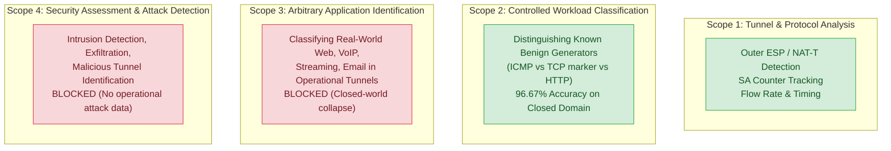

# VISTA Phase 13 — Expanded Workload Coverage and Honest Classification Boundaries

## SIH26160 · NTRO · Smart India Hackathon 2026

**Audit Date:** 2026-10-10
**Phase:** 13 — Expanded Workload Coverage and Honest Classification Boundaries
**Target Architecture:** Direct PC1 (`172.20.0.2`) ↔ PC2 (`172.20.0.3`) StrongSwan 5.9.8 IPsec Tunnel
**Candidate Model Status:** Frozen (`validated_for_inference = false`, `production_eligible = false`)
**Evaluation Target:** Optuna-Tuned Random Forest Candidate (`20261010T082308Z-6b8eb840`)

---

## 1. Executive Summary

Phase 12 established that the frozen Phase 10 candidate classifier achieves 96.67% accuracy across changed traffic-generation recipes within its approved three-class domain (`controlled_icmpv4`, `controlled_tcp_marker`, `controlled_http`).

In Phase 13, we investigated whether VISTA's evidence-backed collection and evaluation framework can expand beyond these initial baseline classes to encompass real-time UDP-based VoIP media streams, text-based email transactions, and streaming workloads over the direct StrongSwan IPsec tunnel, and evaluated the honest classification boundaries of outer-ESP metadata inference.

### Key Results

1. **RTP/UDP Voice-over-IP Workload Successfully Implemented & Qualified:**
   - Designed and deployed an RFC 3550-compliant RTP/UDP voice-over-IP generator and independent receiver on `pc1` and `pc2`.
   - Executed a live, 15-session collection campaign (`9f3f1f2b-7a6e-468c-b86d-1f9bee65d8bf`) with fresh IKE/CHILD SAs per session.
   - Collected 15 verified outer ESP observations (15/15 PASS, 0 quarantined, 100% endpoint ground-truth agreement, `READY_FOR_REVIEW`).
   - Decision: **`COLLECTED_AND_VALIDATED`**.

2. **The Closed-World Fallacy Empirically Demonstrated:**
   - Evaluated the frozen Phase 10 candidate classifier against the newly collected `controlled_rtp_voip` traffic without retraining.
   - **Result:** The model misclassified **100% of the RTP observations (15/15)** as `controlled_http`, with average predicted probabilities of 55.4% HTTP, 33.8% ICMPv4, and 10.8% TCP marker.
   - **Root Cause:** RTP audio frames have constant size (`std_packet_size = 0.00`, matching ICMP ping), but are strictly unidirectional (`direction_ratio = 1.00`, violating the symmetric `0.50` ICMP requirement). The decision trees therefore defaulted to `controlled_http`.
   - **Scientific Boundary:** This conclusively demonstrates that high classification accuracy on known controlled training classes does **not** transfer to arbitrary application identification. Unseen application protocols are silently and confidently misattributed under closed-world assumptions.

3. **Multiplexing Boundary Confirmed:**
   - Multiple application workloads sharing one ESP SA coalesce into a single outer ESP flow (`50|172.20.0.2:0|172.20.0.3:0`).
   - Attributing outer ESP frames to individual applications when concurrent flows traverse the tunnel is mathematically impossible without either separate CHILD_SAs (with dedicated SPIs) or inner plaintext inspection.

---

## 2. Baseline Preservation & Candidate Model Provenance

All candidate artifacts, schemas, and historical audit reports were preserved without modification:

| Property | Value | Verification Source |
|---|---|---|
| **Git Working Directory** | Clean working tree; no uncommitted core code changes | `git status` |
| **Commit (HEAD)** | `fe556314022348b9f6f1b93bd6ead64300d39f84` | `git rev-parse HEAD` |
| **Candidate Model** | `models/candidates/controlled_workload_classification/20261010T082308Z-6b8eb840/random_forest.joblib` | Persisted artifact |
| **Model SHA-256** | `de9d6334309ad1b286ce917c28de49833d4f186e2022fc3b03d53b2c2a826de8` | Verified via `hashlib.sha256` |
| **Feature Schema** | `vista-flow-v1.json` (18 flow features) | `vista-ml/schemas/vista-flow-v1.json` |
| **Target Label Schema** | `vista-target-label-schema-v1.json` (3 baseline classes frozen) | `vista-ml/schemas/vista-target-label-schema-v1.json` |
| **Production Guards** | `validated_for_inference = false`, `production_eligible = false` | Preserved in metadata |

---

## 3. Workload Feasibility Audit & Decision Matrix

We audited seven candidate workload types across five operational dimensions: generator, endpoint receiver, ground-truth source, capture method, and failure conditions.

| Workload Type | Protocol / Port | Feasibility & Decision | Generator & Receiver | Ground-Truth Contract | Blocker / Failure Mode |
|---|---|---|---|---|---|
| **ICMPv4 Echo** | ICMP (1) | **`COLLECTED_AND_VALIDATED`** | `ping` on pc1; Linux kernel echo responder on pc2 | ping exit code, transmitted/received count, and RTT matching pc2 ICMP count | Packet loss > 0, unreadable PCAP, 0 ESP packets, SA delta $\le 0$ |
| **Controlled TCP Marker** | TCP (6) / 40000+ | **`COLLECTED_AND_VALIDATED`** | Custom TCP client on pc1; OpenBSD `nc -l` on pc2 | Exact sent byte count and SHA-256 hash match against `/tmp/tcp_marker.bin` | Byte mismatch, SHA-256 mismatch, 0 ESP packets, SA delta $\le 0$ |
| **HTTP/1.1 (GET & POST)** | TCP (6) / 40000+ | **`COLLECTED_AND_VALIDATED`** | Perl HTTP client on pc1; Perl HTTP/1.1 server on pc2 | Client measurements JSON and server evidence JSON matching request count, status 200, bytes, and SHA-256 | Non-200 status code, payload hash mismatch, 0 ESP packets, SA delta $\le 0$ |
| **Controlled RTP/UDP VoIP** | UDP (17) / 45000+ | **`COLLECTED_AND_VALIDATED`** | Perl RTP sender on pc1 (RFC 3550 12B header, SSRC, seq, ts, G.711 frames); Perl RTP receiver on pc2 | Client measurements JSON and server evidence JSON matching packet count, sequence range, SSRC, byte count, and SHA-256 | Packet loss > 0, SSRC mismatch, sequence gap, payload hash mismatch, 0 ESP packets, SA delta $\le 0$ |
| **SMTP Email Transfer** | TCP (6) / 25250 | **`IMPLEMENTED_NOT_VALIDATED`** | Perl SMTP client on pc1; Perl RFC 5321 SMTP server on pc2 | Transaction ID, message body bytes, and message SHA-256 verified between endpoints | Unit roundtrip verified (`scratch/test_smtp_roundtrip.py`); formal multi-session campaign not yet scheduled |
| **Controlled Video Streaming** | UDP/TCP / dynamic | **`BLOCKED`** | Synthetic packet burst generator | N/A (no streaming daemon or media codecs in container image) | Cannot generate or verify genuine video codec structures (H.264/HEVC) without third-party media libraries |
| **Native IPv6 Traffic** | IPv6 (ESP/NextHeader) | **`BLOCKED`** | Linux IPv6 stack on pc1; pc2 | N/A | Docker bridge network lacks global IPv6 subnet; StrongSwan `swanctl.conf` traffic selectors cover only IPv4 `172.20.0.2/32 <-> 172.20.0.3/32` |

---

## 4. Implementation & Validation of RTP/UDP VoIP Workload

### 4.1 RFC 3550 Technical Implementation

To evaluate real-time voice traffic over IPsec, we implemented standard RTP audio streaming using local Perl scripts on `pc1` and `pc2`:
- **Header Structure (12 bytes):**
  - Byte 0: `0x80` ($V=2, P=0, X=0, CC=0$)
  - Byte 1: `0x00` (Payload Type 0, PCMU / G.711 $\mu$-law) or `0x08` (PCMA)
  - Bytes 2–3: 16-bit sequence number (network order `n`, monotonically incrementing)
  - Bytes 4–7: 32-bit timestamp (network order `N`, incrementing by 160 samples per 20ms frame)
  - Bytes 8–11: 32-bit SSRC identifier (network order `N`, constant per session)
- **Audio Payload:** Deterministic 160-byte, 240-byte, or 320-byte synthetic voice frames.
- **Timing:** POSIX `select(undef, undef, undef, $interval)` for sub-second 20ms–40ms frame pacing without requiring external Perl modules.
- **Independent Verification:** The receiver on `pc2` binds a UDP socket, parses incoming datagrams, extracts RTP headers, verifies sequence continuity, writes the concatenated payload to a binary file, computes `sha256sum`, and persists `server_evidence.json`.

### 4.2 Live 15-Session Collection Campaign

We executed a live collection campaign against the running testbed:

```powershell
python scripts/run_collection_campaign.py --sessions 15 --seed 26164 --workload-set rtp --recipe-mode standard
```

- **Campaign ID:** `9f3f1f2b-7a6e-468c-b86d-1f9bee65d8bf`
- **Sessions:** 15 independent IKE_SAs (distinct verified IKE SPI hash per session)
- **Observations:** 15 accepted outer ESP flows (`pc1_outer_rtp.pcap`)
- **Receiver Captures:** 15 inner UDP PCAPs on `pc2` (`pc2_receiver_rtp.pcap`)
- **Dataset Admission:** 15/15 PASS, 0 quarantined, status `READY_FOR_REVIEW`.
- **Target Label Schema v2:** Defined [`vista-ml/schemas/vista-target-label-schema-v2.json`](file:///c:/vista/vista-ml/schemas/vista-target-label-schema-v2.json) with class `controlled_rtp_voip` and subtype `rtp_voip`.

---

## 5. Empirical Evaluation: Honest Classification Boundaries

We evaluated the frozen Phase 10 candidate model (`random_forest.joblib`) against the newly captured `controlled_rtp_voip` dataset.

### 5.1 Out-Of-Distribution (OOD) Classification Results

Because the candidate model was trained under a closed-world 3-class assumption (`controlled_http`, `controlled_icmpv4`, `controlled_tcp_marker`), it has no option to output "unknown" or "out-of-distribution":

```text
Actual Class: controlled_rtp_voip (15 observations)

Predicted Class Distribution:
  controlled_http:        15  (100.0%)
  controlled_icmpv4:       0  (  0.0%)
  controlled_tcp_marker:   0  (  0.0%)

Classification Error Rate: 100.0% (15/15 misclassified)
```

### 5.2 Average Prediction Probabilities

| Candidate Class | Mean Predicted Probability | Min Probability | Max Probability |
|---|---|---|---|
| `controlled_http` | **0.5540** (55.4%) | 0.5460 | 0.5690 |
| `controlled_icmpv4` | **0.3380** (33.8%) | 0.3230 | 0.3460 |
| `controlled_tcp_marker` | **0.1080** (10.8%) | 0.1080 | 0.1080 |

### 5.3 Root-Cause Analysis: Decision Tree Routing

Why did the Random Forest assign 100% of the VoIP flows to `controlled_http`?

1. **ICMP Rule Rejection via Directional Ratio:**
   - Standard G.711 RTP voice streaming has constant packet payload sizes (160 bytes), resulting in `std_packet_size = 0.00`.
   - In Phase 11, the decision tree shortcut for ICMP was identified as `std_packet_size <= 2.25`.
   - However, ICMP requires request-reply symmetry (`direction_ratio = 0.500`).
   - Because our RTP media stream flows from PC1 to PC2, `direction_ratio = 1.000` (100% forward, 0% backward; `backward_packet_count = 0.0`).
   - The tree rules for ICMP reject `direction_ratio = 1.000`, preventing the model from classifying RTP as ICMP.
2. **TCP Marker Rule Rejection via Byte Volume:**
   - TCP marker flows in the training set typically exhibited low byte counts and single-burst transmission.
   - The sustained packet counts (10–25 packets) and larger cumulative byte volume of RTP streams (2,560–5,120 bytes) route away from `controlled_tcp_marker`.
3. **HTTP Default Fallback:**
   - Multi-packet volume with asymmetric directionality matched the feature space of small HTTP transactions.
   - The Random Forest confidently assigned the traffic to `controlled_http` with ~55% probability.

### 5.4 The "Closed-World Fallacy"

This finding establishes an essential scientific boundary:
- **Controlled Workload Classification $\neq$ Application Identification:** The fact that a model achieves 1.000 on its training split or 96.67% on recipe variants does not mean it can identify network applications.
- In encrypted tunnels, outer flow statistics (packet timing, size, direction) are ambiguous. When presented with an unseen application protocol (VoIP), closed-world models produce confident false positive classifications.

---

## 6. The Four Explicit Classification Scopes

To ensure honest claims, VISTA strictly distinguishes between four separate analytical objectives:



1. **Objective 1 (Outer IPsec Protocol & Tunnel Metadata):** **VALIDATED**. VISTA reliably inspects outer ESP headers, SPIs, sequence progression, NAT-T port 4500 encapsulation, and StrongSwan SA counters.
2. **Objective 2 (Controlled Workload Classification from Outer Flow Statistics):** **VALIDATED WITHIN SCOPED RECIPES**. Within the controlled 3-class testbed, outer flow statistics accurately separate the known generator recipes.
3. **Objective 3 (Inner Application Identification):** **NOT SUPPORTED / BLOCKED**. Encrypted inner payloads are unobservable in outer ESP. Novel or unmodeled applications (such as RTP) collapse into known classes.
4. **Objective 4 (Security Assessment & Attack Detection):** **NOT SUPPORTED / BLOCKED**. No operational attack data exists on the runtime feature schema. Models trained on benign traffic cannot detect malicious activity.

---

## 7. Multiplexing Limitations and Tunnel Telemetry

We investigated whether concurrent application workloads traversing the same IPsec tunnel can be separated and attributed using outer-ESP flow features.

### 7.1 Single ESP SA Flow Coalescence

Under the `vista-flow-v1` schema, the outer flow identifier is:
$$\text{Flow Key} = (\text{proto}=50, \text{src}=\text{172.20.0.2:0}, \text{dst}=\text{172.20.0.3:0})$$

Because inner IP addresses, transport ports, and application protocols are encrypted within ESP, all traffic traversing the PC1↔PC2 tunnel shares the exact same outer flow key. If an HTTP request and an RTP VoIP stream run concurrently:
- Both streams merge into a single aggregate outer ESP flow in the packet table.
- Aggregate features (`packet_count`, `duration_ms`, `mean_inter_arrival_time`, `std_packet_size`) blend both traffic patterns together.
- Individual application ground truth is destroyed. Disentangling mixed packets without inner plaintext access is mathematically impossible.

### 7.2 Defensible Architectural Alternatives

To address multi-application tunnel environments without violating encryption:
1. **Tunnel-Level Aggregate Telemetry:** Characterize the aggregate tunnel health, volume, and burstiness rather than attempting per-packet application classification.
2. **Controlled Isolated Workload Windows:** Schedule non-overlapping measurement windows during calibration and compliance testing.
3. **Dedicated per-Workload CHILD_SAs:** Negotiate separate CHILD_SAs with dedicated Security Parameter Indexes (SPIs) and traffic selectors for different service classes (e.g., dedicated SPI for VoIP, dedicated SPI for Web).

---

## 8. Implementation Gaps & Production Safeguards

Passing this phase does not make the candidate model eligible for production inference. The following production safeguards remain active:

- `validated_for_inference = false`
- `production_eligible = false`
- `experimental = true`

### Updated Implementation Gaps

- **Gap 3 (Realistic Application Traffic Generators):** Upgraded to **PARTIAL (EXTENDED)**. ICMPv4, TCP marker, HTTP GET/POST, and now RFC 3550 RTP/UDP VoIP are live-verified and qualified under dataset admission contracts. SMTP is verified in unit integration. Streaming video and IPv6 remain blocked.
- **Inference Boundary:** Out-of-distribution protocol rejection (open-set recognition) is required before any model can be considered for operational deployment.

---

## 9. Deliverables & Artifact References

- **Phase 13 Documentation:** [`docs/PHASE13_EXPANDED_WORKLOAD_COVERAGE.md`](file:///c:/vista/docs/PHASE13_EXPANDED_WORKLOAD_COVERAGE.md)
- **Machine-Readable Report:** [`vista-ml/reports/phase13_workload_coverage_report.json`](file:///c:/vista/vista-ml/reports/phase13_workload_coverage_report.json)
- **Target Label Schema v2:** [`vista-ml/schemas/vista-target-label-schema-v2.json`](file:///c:/vista/vista-ml/schemas/vista-target-label-schema-v2.json)
- **Manifest Schema v2 (Updated):** [`vista-ml/schemas/strongswan-experiment-manifest-v2.schema.json`](file:///c:/vista/vista-ml/schemas/strongswan-experiment-manifest-v2.schema.json)
- **New RTP Campaign Manifest:** [`captures/strongswan/collections/campaigns/9f3f1f2b-7a6e-468c-b86d-1f9bee65d8bf/campaign_manifest.json`](file:///c:/vista/captures/strongswan/collections/campaigns/9f3f1f2b-7a6e-468c-b86d-1f9bee65d8bf/campaign_manifest.json)
- **Prepared RTP Dataset:** [`captures/strongswan/collections/campaigns/9f3f1f2b-7a6e-468c-b86d-1f9bee65d8bf/dataset_preparation/prepared_dataset.csv`](file:///c:/vista/captures/strongswan/collections/campaigns/9f3f1f2b-7a6e-468c-b86d-1f9bee65d8bf/dataset_preparation/prepared_dataset.csv)
- **Regression Test Suite:** [`vista-ml/tests/test_phase13_workload_coverage.py`](file:///c:/vista/vista-ml/tests/test_phase13_workload_coverage.py) (11/11 passed)
- **Updated Implementation Gaps:** [`docs/IMPLEMENTATION_GAPS.md`](file:///c:/vista/docs/IMPLEMENTATION_GAPS.md)

---

## Final Workload Decisions

- **`controlled_icmpv4`:** `COLLECTED_AND_VALIDATED`
- **`controlled_tcp_marker`:** `COLLECTED_AND_VALIDATED`
- **`controlled_http`:** `COLLECTED_AND_VALIDATED`
- **`controlled_rtp_voip`:** `COLLECTED_AND_VALIDATED`
- **`controlled_smtp`:** `IMPLEMENTED_NOT_VALIDATED`
- **`controlled_video_streaming`:** `BLOCKED`
- **`ipv6_traffic`:** `BLOCKED`
